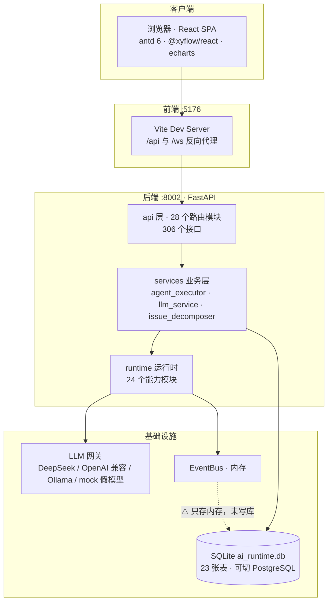

# 李金路 AI Agent 开发工厂

> 一个全自动化的专业软件开发平台 —— 需求进来，Agent 组队把代码写出来。

后端是一套 **AI Runtime OS**：把「需求 → 任务分解 → Agent 编排 → 代码生成 → 自检 → 交付」拆成可观测的流水线，对外暴露 306 个 REST 接口 + WebSocket 实时通道；前端是一个 28 个页面的运维控制台，用来盯着这些 Agent 到底在干什么。

---

## 一眼看现状

| 维度 | 现状 |
|---|---|
| 后端规模 | 227 个 Python 文件，306 个接口（255 条路径 / 28 个路由模块），23 张数据表 |
| 前端规模 | 107 个 TS/TSX 文件，28 个页面，`tsc --noEmit` 与 `npm run build` 通过 |
| 测试 | 29 个测试文件，**全新虚拟环境实测 1542 项全部通过**（73 秒） |
| 软件骨架 | ✅ 完整：认证、任务、Agent、流水线、产物、成本、评估、多租户、K8s 调度都有 |
| 端到端出码 | ⚠️ **尚未打通**，详见 [已知断链](#已知断链) |
| 计费能力 | ✅ LLM 调用记账、成本看板（`llm_calls` 表 + `/costs` 接口）已可用 |

这个项目**不是** Demo 糊出来的空壳 —— 接口和页面都是真的，但它现在还不能真的把一句话需求变成能跑的代码。三条断链就横在中间，README 里如实写出来了。

---

## 架构



### 运行时能力模块（`backend/app/runtime/`）

| 分类 | 模块 |
|---|---|
| 执行 | `execution_engine`（LangGraph 适配）、`task_dispatcher`、`scheduler`、`worker_manager`、`planner`、`loop_detector` |
| 状态 | `state_manager`、`checkpoint_manager`、`recovery_manager`、`artifact_store`、`context_engine` |
| 治理 | `policy_engine`、`evaluation`、`runtime_monitor`、`performance` |
| 扩展 | `model_router`、`tool_runtime`、`sandbox`、`marketplace`、`federation`、`multi_node`、`tenant`、`k8s_scheduler` |

---

## 技术栈

**后端** — Python 3.11+（本机 3.13）

- FastAPI 0.115+ / Uvicorn / Pydantic 2
- LangGraph 0.4–0.6 + LangChain 0.3（工作流编排）
- SQLAlchemy 2.0 async + `aiosqlite`（开发）/ `asyncpg`（生产）+ Alembic
- LLM：DeepSeek（OpenAI 兼容协议）、Ollama 兜底、`mock:` 前缀假模型

**前端** — Node 18+

- React 19.2 + TypeScript 6.0 + Vite 8
- antd 6.4、@xyflow/react 12（画布编排）、zustand 5（状态）、
  @tanstack/react-query 5（数据）、echarts 6（图表）、@dnd-kit（拖拽）

---

## 目录结构

```
ai-agent-os/
├── backend/
│   ├── app/
│   │   ├── main.py            # FastAPI 入口，聚合 28 个 router
│   │   ├── config.py          # pydantic-settings，读 .env
│   │   ├── api/               # 路由层，一模块一文件
│   │   ├── models/            # SQLAlchemy ORM，23 张表
│   │   ├── schemas/           # Pydantic 请求/响应模型
│   │   ├── services/          # 业务层：agent 执行、LLM 网关、Issue 拆解
│   │   ├── runtime/           # 运行时能力（24 个子模块）
│   │   ├── core/              # EventBus、SSE、安全、数据库引擎
│   │   └── prompts/           # Agent 提示词模板
│   ├── tests/                 # 29 个测试文件 / 1542 项实测通过
│   ├── requirements.txt           # 依赖（版本下限）
│   ├── requirements.lock.txt      # 依赖（精确锁定，可复现）
│   ├── requirements-optional.txt  # 可选能力依赖
│   ├── .env.example               # 全部配置项说明
│   └── docker-compose.yml         # postgres + redis
├── frontend/
│   ├── src/
│   │   ├── pages/             # 28 个页面
│   │   ├── api/               # 按模块划分的请求函数
│   │   ├── stores/            # zustand
│   │   └── components/
│   ├── package-lock.json      # 前端精确版本锁定
│   └── .nvmrc                 # Node 22
├── scripts/
│   ├── setup.ps1              # Windows 一键环境准备
│   └── setup.sh               # macOS / Linux 一键环境准备
├── docs/                      # 架构设计、开发计划、修复报告（14 篇）
├── k8s/                       # 部署清单
└── DEVELOPMENT.md             # 开发运行手册（更细的操作步骤）
```

---

## 环境准备

仓库里**只放代码，不放环境** —— `node_modules`、`.venv`、`*.db`、`.env` 全在 `.gitignore` 里。
原因很简单：`node_modules` 十几万个文件、venv 里全是跟平台绑定的二进制（Windows 的 `.pyd` 在 Linux 上没用），
提交它们只会让仓库膨胀到几百 MB 且换机器仍然跑不起来。

可复现性靠的是三样东西，都已经在库里：

| 文件 | 作用 |
|---|---|
| `frontend/package-lock.json` | 锁定前端每个包的精确版本 |
| `backend/requirements.lock.txt` | 锁定后端 77 个包的精确版本（由实测可用的 `.venv` 生成） |
| `backend/.env.example` | 列出全部 15 个配置项，照着填即可 |

> 这套依赖清单已经在**全新虚拟环境里从零装过一遍**并跑通全部 1542 项测试（Python 3.13，2026-11-20 验证）。
> 之前 `requirements.txt` 漏掉了 `PyJWT` 和 `bcrypt`（都是模块顶层 import），照旧清单装完服务根本起不来，已修正。

### 方式一：一键脚本（推荐）

```bash
# Windows
pwsh -File scripts\setup.ps1

# macOS / Linux
bash scripts/setup.sh
```

脚本会依次完成：检查 Python/Node 版本 → 建 `backend/.venv` → 装依赖 → 从 `.env.example` 生成 `.env`
→ `npm install`，然后打印后续启动命令。可重复执行，已存在的东西不会覆盖。

想 100% 复现开发机上的版本：`bash scripts/setup.sh --locked`（Windows 加 `-Locked`）。

### 方式二：手动

```bash
# 后端
cd backend
python -m venv .venv
.venv\Scripts\python.exe -m pip install -r requirements.txt     # Windows
# .venv/bin/python -m pip install -r requirements.txt           # macOS / Linux
cp .env.example .env

# 前端
cd ../frontend
npm install
```

### 方式三：只要基础设施（可选）

不装 SQLite 以外的东西也能跑。需要 PostgreSQL + pgvector 或 Redis 时：

```bash
cd backend
docker compose up -d          # postgres:5432 / redis:6379
```

### 可选能力依赖

下面这些是「函数内延迟 import」的，不装也能启动，只影响对应功能：

```bash
cd backend
.venv\Scripts\python.exe -m pip install -r requirements-optional.txt
```

PDF/Word 文本抽取（`PyPDF2`、`python-docx`）、向量检索（`faiss-cpu`）、
K8s 调度（`kubernetes`）、浏览器沙箱（`playwright`）。

### 环境变量

`.env` 必填的四个键（其余有合理默认值）：

| 变量 | 说明 | 示例 |
|---|---|---|
| `OPENAI_API_KEY` | LLM 密钥（DeepSeek 或其他 OpenAI 兼容服务） | `sk-...` |
| `OPENAI_BASE_URL` | 兼容接口地址 | `https://api.deepseek.com/v1` |
| `SECRET_KEY` | JWT 签名密钥，**生产必须换成随机强密钥** | `python -c "import secrets;print(secrets.token_hex(32))"` |
| `DATABASE_URL` | 数据库连接串，默认 SQLite 无需安装 | `sqlite+aiosqlite:///./ai_runtime.db` |

没有可用 key 时也能验证链路：`DEFAULT_LLM_MODEL=mock:test`，会返回固定假数据、不产生费用。

**三个容易踩的坑**：

1. `.env` 是相对「进程工作目录」读的（`config.py` 里 `env_file=".env"`），所以**必须在 `backend/` 目录下启动** uvicorn，否则配置不生效、表现为「明明填了 key 却说没配」。
2. **表是启动时自动建的**，前提是 `DEBUG=true`（`main.py:194` 的 `if settings.debug: await init_db()`）。首次运行别把 DEBUG 改成 false，否则连表都没有。
3. `app/seed.py` 没有去重保护，**重复执行会因唯一约束报错**，灌一次就够。

---

## 快速开始

### 1. 灌种子数据（只跑一次）

```bash
cd backend
.venv\Scripts\python.exe -m app.seed          # Windows
# .venv/bin/python -m app.seed                # macOS / Linux
```

写入默认角色权限、预设 Agent 等基础数据。注意是 `-m app.seed`，不是 `python seed.py`
（脚本在 `backend/app/seed.py`，不在 `backend/` 根下）。

### 2. 启动后端

```bash
cd backend
.venv\Scripts\python.exe -m uvicorn app.main:app --host 127.0.0.1 --port 8002 --reload
```

- Swagger UI：http://127.0.0.1:8002/docs
- OpenAPI：http://127.0.0.1:8002/openapi.json
- 首次启动会自动建表（需 `DEBUG=true`）

### 3. 启动前端

```bash
cd frontend
npm run dev
```

- 控制台：http://localhost:5176
- `/api` 与 `/ws` 由 Vite 代理到 `127.0.0.1:8002`，无需处理跨域

### 4. 造一个账号

```bash
curl -X POST http://127.0.0.1:8002/api/v1/auth/register \
  -H "Content-Type: application/json" \
  -d '{"username":"admin","password":"admin123","email":"admin@example.com"}'
```

---

## 接口概览（306 个）

按路由分组统计（数字来自运行中的 `/openapi.json`）：

| 分组 | 数量 | 分组 | 数量 |
|---|---:|---|---:|
| RuntimeOps 运维 | 39 | Artifacts 产物 | 9 |
| Federation 联邦 | 34 | Costs 成本 | 7 |
| Tenants 多租户 | 26 | Tools 工具 | 7 |
| Marketplace 市场 | 22 | Agents | 6 |
| Performance 性能 | 21 | Events 事件 | 6 |
| Issues | 16 | Projects | 5 |
| K8s Scheduler | 13 | Skills | 4 |
| Multi-Node | 13 | Memory | 4 |
| Settings | 12 | Auth | 4 |
| Evaluation 评估 | 12 | Traces | 3 |
| Context 上下文 | 11 | Dashboard | 2 |
| Pipelines | 10 | 其他 | 1 |
| State & Checkpoints | 10 | **合计** | **306** |

---

## 数据模型（23 张表）

| 域 | 表 |
|---|---|
| 账号与配置 | `users`、`api_keys`、`agent_permissions`、`runtime_settings`、`model_configs` |
| Agent 与执行 | `agents`、`tasks`、`task_checkpoints`、`tool_definitions`、`tool_executions`、`skills` |
| 项目与流程 | `projects`、`pipeline_templates`、`pipeline_runs`、`issues`、`issue_attachments`、`comments` |
| 运行时数据 | `events`、`artifacts`、`memories`、`context_index`、`llm_calls`、`evaluation_records` |

---

## 已知断链

这三条是「现在还产不出真实代码」的主要原因，按修复优先级排列。

### ① LLM 账户欠费，所有真实调用返回 402

**证据**：`GET https://api.deepseek.com/v1/user/balance` 返回
`{"is_available": false, "total_balance": "-2.92", "currency": "CNY"}`

**影响**：任何走到 LLM 的 Agent 执行都会失败。此前全部功能验证都是靠 `mock:` 前缀的假模型
（`backend/app/services/llm_service.py:182`）跑通的 —— 它验证的是链路形状，不是推理质量。

**修复**：充值或换一个可用 key，改 `backend/.env` 的 `OPENAI_API_KEY` / `OPENAI_BASE_URL`，
重启后端即可，无需改代码。

### ② 流水线的 Agent 步骤静默空转，且最终仍标记「已完成」

**证据**：

- `backend/app/api/pipelines.py:201` 用 `step.get("agent_role", "developer")` 取角色，
  但模板里存的是**空字符串**或 Agent 的 **UUID**（如 `a0f674f2-…`）；
- 而查询条件是 `Agent.role == agent_role AND Agent.status == "idle"` ——
  库里 5 个 Agent 的 `role` 是 `architect` / `developer` / 中文名，全都匹配不上；
- 匹配失败执行 `if not agent: return`（`pipelines.py:214-216`），**不报错、不产出、不记录**；
- 非 agent 类型的步骤走 `_execute_generic_step`，那是 `asyncio.sleep(0.5)` 纯延时（`pipelines.py:245`）；
- 循环结束后 `run.status = "completed"` 是**无条件**赋值的（`pipelines.py:159-161`），
  所以哪怕每一步都空转，前端看到的仍是「流水线全部成功，0 失败」。

**修复方向**：步骤里存 `agent_id` 而非 `role` 字符串；空值时回退到默认角色而非空串；
匹配失败应抛异常并计入 `failed_steps`；`completed` 只在 `completed_steps == total_steps` 时设置。

### ③ EventBus 只写内存，事件永远不落库

**证据**：

- `backend/app/core/event_bus.py:62-76` 的 `publish()` 只把事件 append 进内存字典 `self._history`，
  全程没有数据库写入；
- 而 `backend/app/api/events.py:99` 查询的是 DB 里的 `Event` 表 —— 实测 `events` 表 **0 行**。

**影响**：事件总线页、事件回放页、Trace 页永远空白。这些页面本身是好的，只是没有数据可读。
服务重启后内存事件也一并丢失。

**修复方向**：在 `publish()` 里加一个持久化 subscriber，或在每次 publish 后 `INSERT INTO events`；
写入要复用调用方的事务或独立短事务，避免拖慢执行路径。

---

## 开发

```bash
# 后端测试（29 个文件，实测 1542 项通过）
cd backend && .venv\Scripts\python.exe -m pytest -q

# 前端类型检查 + 构建
cd frontend && npx tsc --noEmit && npm run build
```

`backend/pytest.ini` 已把收集范围限定在 `tests/`。`backend/` 根下的
`test_auth.py` / `test_ws_app.py` / `test_ws_minimal.py` 是「需要先手动起后端」的联调脚本，
模块级就会发 HTTP 请求，**不要**用 pytest 直接跑它们，否则 collection 阶段直接 404 中断。

更细的操作流程、新增功能的三步走示例见 [DEVELOPMENT.md](DEVELOPMENT.md)；
架构设计与历次修复记录见 [docs/](docs/)。

**提交约定**：Conventional Commits（`feat:` / `fix:` / `chore:` / `docs:`），
`fix:` 需在正文里说明根因，不要只写「修复 bug」。

---

## 路线图

- [ ] **P0** 接通可用 LLM，跑通「一句话需求 → 产出可运行代码」的最小闭环
- [ ] **P0** 修掉断链 ②，让流水线步骤要么真执行、要么显式失败
- [ ] **P0** 修掉断链 ③，事件落库，把回放和 Trace 点亮
- [ ] P1 补齐 `_execute_generic_step` 的条件判断 / 审查 / 部署真实逻辑
- [ ] P1 沙箱执行结果的自动回归验证接进流水线
- [ ] P2 多租户与联邦模块的权限隔离压测

---

## License

[Apache License 2.0](LICENSE)
